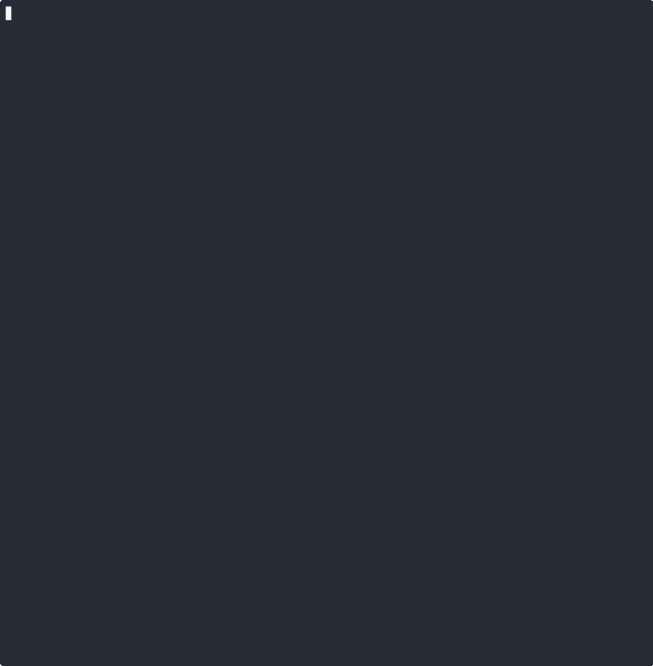

# nextjs-supabase-stripe-security-checker

A free static scanner for the security mistakes that keep showing up in **Next.js + Supabase + Stripe** apps, especially ones written with AI coding agents. It runs **20 deterministic checks**, uses AST parsing (Babel) where regex would be fragile, and needs no network access and no account.



## Install and run

Not published to npm yet. Clone it and run it locally:

```bash
git clone https://github.com/edtrackai/nextjs-supabase-stripe-security-checker.git
cd nextjs-supabase-stripe-security-checker
npm install            # one dependency: @babel/parser
node bin/nss-security-check.js /path/to/your/app
```

Requires Node 18 or later.

### Options

| Flag | What it does |
|---|---|
| `--json` | Machine-readable output: `{tool, version, root, filesScanned, counts, findings[]}` |
| `--fail-on=<sev>` | Exit 1 if any finding is at or above `critical` / `high` / `medium` / `low` (`none` never fails). Exit 2 for bad arguments. |
| `--list` | Print the check catalogue |
| `--help` | Usage |

### Use in CI

```bash
node path/to/nss-security-check.js . --fail-on=high
```

## The 20 checks

| ID | Severity | Area | Check |
|---|---|---|---|
| K1 | critical | Keys | Live Stripe secret/restricted key (`sk_live_`/`rk_live_`) in source, including keys split with `+` (evidence is redacted) |
| K2 | critical | Keys | Secret-looking `NEXT_PUBLIC_` variable (service role, secret key, webhook secret…) |
| K3 | critical | Keys | `.env` file with values tracked by git |
| K4 | critical | Keys | Server secret or Supabase admin client used in a `"use client"` component |
| A1 | high | Auth | `auth.getSession()` trusted on the server instead of `getUser()`/`getClaims()` |
| A2 | high | Auth | Server Action writes data with no auth check |
| A3 | high | Auth | API route (POST/PUT/PATCH/DELETE) writes data with no auth check (webhook, cron and auth routes excluded) |
| A4 | high | Auth | Admin client queried by a request-supplied id with no owner filter (IDOR) |
| A5 | medium | Auth | Open redirect from a query parameter |
| R1 | critical | RLS | Table created without row level security |
| R2 | critical | RLS | Write policy with `using (true)` / `with check (true)` |
| R3 | high | RLS | Policy that lets the `anon` role write |
| R4 | high | RLS | `security definer` function without a fixed `search_path` |
| S1 | critical | Stripe | Webhook without signature verification (`constructEvent`) |
| S2 | critical | Stripe | Webhook parses `request.json()` instead of the raw body |
| S3 | medium | Stripe | Webhook has no idempotency on `event.id` |
| S4 | high | Stripe | Checkout price or amount taken from the request |
| S5 | high | Stripe | Access granted on the checkout success page instead of in the webhook |
| H1 | medium | Hardening | No security headers in `next.config` |
| H2 | medium | Hardening | `dangerouslySetInnerHTML` with a non-literal value |

## How it's tested

- `fixtures/vulnerable-app` triggers all 19 file-based checks, and the tests assert each one at the expected file. K3 is tested on a temporary git repo.
- `fixtures/clean-app` (a hardened reference app) and `fixtures/near-miss` (safe code that *looks* like each mistake: raw-body webhooks with idempotency, guarded redirects, owner-filtered admin queries, `select using (true)`, JSON-LD) must produce **0 findings**.
- `npm test` runs the node:test suite, including the CLI flags and exit codes. `npm run smoke` gives a one-line summary.

## Honest limits

- It's a **heuristic static scanner**. A clean run doesn't prove an app is secure, and a finding is a prompt to review, not a verdict.
- It doesn't follow data across files or functions. An auth check hidden in a helper it doesn't recognise can produce an A2/A3 false positive. Helpers named like `requireUser*`, `getUser*`, `verifySession*`, `assertAuth*`, `auth()`, `currentUser()` and `protect()` are recognised.
- RLS checks read SQL in `supabase/migrations` and `.sql` files only. Policies created in the dashboard aren't visible to it.
- It doesn't check your live Supabase project, Stripe dashboard settings, dependencies (use `npm audit`) or full git history for secrets (use gitleaks).
- It's a small free subset of the checks in our paid Launch Audit. There's no AI review, no written report and no fix plan here.

## More from Stack & Ship

- [Free Next.js + Supabase + Stripe security checklist](https://luxurydrive0.gumroad.com/l/security-checklist?utm_source=github&utm_medium=readme&utm_campaign=nextjs-supabase-stripe-security-checker)
- [Ship-Ready AI Rules](https://luxurydrive0.gumroad.com/l/ffjsf?utm_source=github&utm_medium=readme&utm_campaign=nextjs-supabase-stripe-security-checker): rules files that stop AI coding agents from writing these bugs in the first place
- [All our AI rules](https://edtrackai.github.io/ai-rules?utm_source=github&utm_medium=readme&utm_campaign=nextjs-supabase-stripe-security-checker)

## License

MIT
